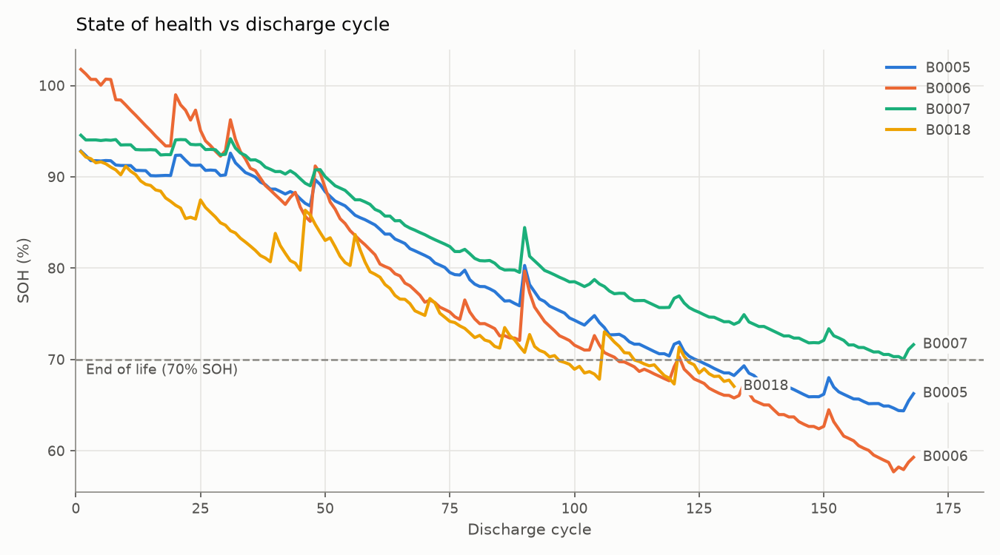
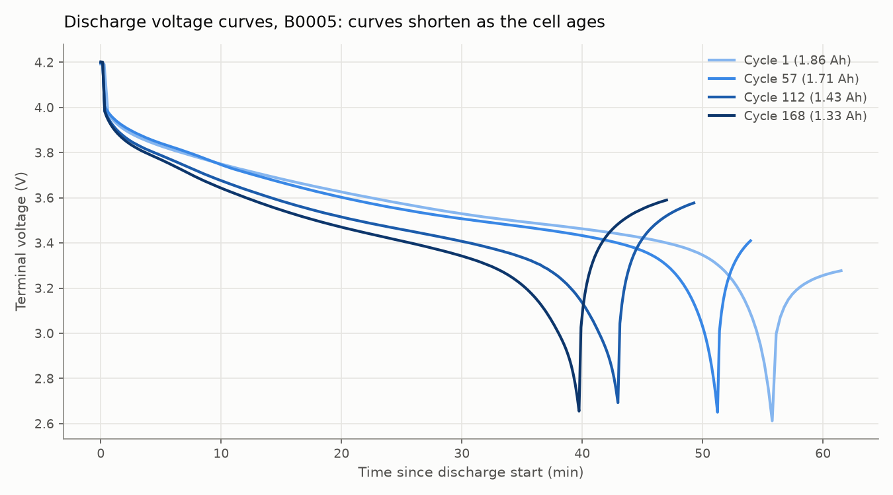
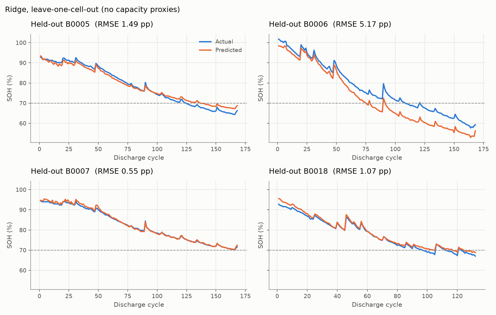
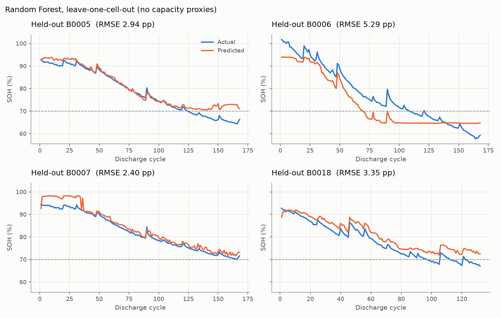
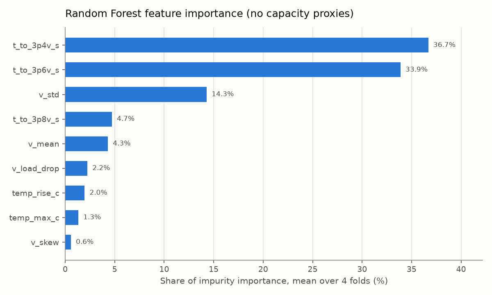
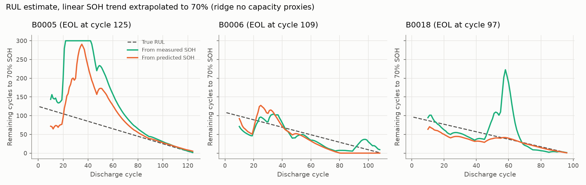

# VoltWise: EV Battery Health & Remaining Life Prediction

Estimating how much capacity a lithium-ion cell has left (**State of Health, SOH**) and how many cycles it can still run (**Remaining Useful Life, RUL**) from its discharge curves, using the NASA PCoE Li-ion Battery Aging Dataset.

Every model is tested on a cell it has never seen. Hyperparameters are chosen on separate validation cells, and the test cell is never used for training or model selection.



## Results at a glance

| Task | Best model | RMSE | MAE |
|---|---|---|---|
| SOH, curve-shape features | Ridge regression | 2.07 pp | 1.82 pp |
| SOH, all features (upper bound) | Ridge regression | 1.11 pp | 1.07 pp |
| RUL | Linear trend on ridge SOH predictions | 36.5 cycles | 26.2 cycles |

*pp = percentage points of SOH. Means over held-out cells: four for SOH, three for RUL.*

**Key findings**

- **Discharge time is almost the answer.** At a constant 2 A, time to empty is effectively a capacity measurement (correlation 0.999 with SOH). Results are reported with and without these "capacity proxy" features. The curve-shape-only set is the honest headline.
- **A linear model beats a forest and an LSTM.** With four cells, flexible models have too little data. Ridge also extrapolates, which trees cannot.
- **RUL is unreliable early in life and accurate late in life.** While SOH is still flat, any trend projection is uncertain. From about cycle 60 the estimate tracks the true RUL closely.

## Problem

EV battery packs lose capacity with use. Measuring that capacity directly needs a full, controlled discharge, which is rarely possible in the field. This project asks how well health and remaining life can be estimated from features of the discharge curve, and is careful about what counts as a fair test.

## Dataset

[NASA PCoE Li-ion Battery Aging Datasets](https://www.nasa.gov/intelligent-systems-division/discovery-and-systems-health/pcoe/pcoe-data-set-repository/), cells B0005, B0006, B0007 and B0018 (B. Saha and K. Goebel, 2007, NASA Ames Research Center).

- Cells cycled at about 24 C: charge at 1.5 A to 4.2 V, discharge at a constant 2 A to 2.7, 2.5, 2.2 and 2.5 V respectively.
- 636 discharge cycles in total (168, 168, 168 and 132 per cell).
- **SOH** = measured capacity / 2.0 Ah rated capacity. **End of life (EOL)** = first cycle at or below 70% SOH (1.4 Ah).

| Cell | Cycles | First SOH | Last SOH | EOL cycle |
|---|---|---|---|---|
| B0005 | 168 | 92.8% | 66.3% | 125 |
| B0006 | 168 | 101.8% | 59.3% | 109 |
| B0007 | 168 | 94.6% | 71.6% | not reached (min 70.02%) |
| B0018 | 132 | 92.8% | 67.1% | 97 |

## Approach

**1. Features.** Each discharge is cut to the segment where the 2 A load is on, then to a common 2.8 V end point so cells with different cutoffs are comparable. Thirteen features are extracted per cycle: time to reach 3.8, 3.6, 3.4, 3.2, 3.0 and 2.8 V; voltage mean, spread and skew; the voltage step when the load switches on (an internal resistance proxy); and peak temperature, time to peak and temperature rise.



**2. Two feature sets.** `all_features` uses all 13. `no_capacity_proxies` drops discharge time, time to 3.0 V, time to 3.2 V and time to peak temperature, which together nearly measure capacity directly. The remaining nine describe the shape of the voltage curve.

**3. Evaluation.** Leave-one-cell-out with a validation stage inside every fold:

- one cell is the **test** cell and is scored exactly once;
- each of the other three takes a turn as the **validation** cell (two train, one validates) to choose hyperparameters;
- the model is refit on all three and scored on the test cell.

Splits are by whole cell, never by random cycles, because neighbouring cycles of one cell are nearly identical.

**4. Models.**

- **Random forest** (300 trees; leaf size and feature fraction tuned on validation).
- **Ridge regression** on standardised features (regularisation strength tuned on validation).
- **LSTM**: one 32-unit layer over the last 10 cycles of features. Each fold trains three models, one per validation cell with early stopping, and averages them.

**5. RUL.** At each cycle, a straight line is fitted to past SOH values and extrapolated to 70%. The trailing window length (20, 30, 50 cycles or full history) is chosen for each cell using only the other cells. B0007 never reaches EOL, so it has no true RUL and is not scored.

## Results

SOH test RMSE in percentage points, per held-out cell:

| Test cell | Forest | Ridge | LSTM | Forest (all) | Ridge (all) | LSTM (all) |
|---|---|---|---|---|---|---|
| B0005 | 2.94 | 1.49 | 2.97 | 0.66 | 0.66 | 0.41 |
| B0006 | 5.29 | 5.17 | 6.10 | 2.70 | 2.53 | 4.18 |
| B0007 | 2.40 | 0.55 | 1.47 | 1.11 | 0.86 | 0.95 |
| B0018 | 3.35 | 1.07 | 5.40 | 0.32 | 0.41 | 1.47 |
| **Mean** | **3.49** | **2.07** | **3.98** | **1.20** | **1.11** | **1.75** |

Columns without "(all)" use the curve-shape features only.



B0006 is the hardest cell for every model: it degrades further than any training cell. Tree models cannot predict below the lowest SOH they saw, so the forest flattens out near 65%.





RUL error in cycles, scored on cycles 10 up to EOL:

| SOH source | B0005 | B0006 | B0018 | Mean RMSE | Mean MAE |
|---|---|---|---|---|---|
| Ridge predictions | 71.1 | 22.2 | 16.3 | **36.5** | **26.2** |
| Measured SOH (reference) | 109.9 | 20.9 | 47.0 | 59.3 | 40.3 |
| LSTM predictions | 115.3 | 47.4 | 132.8 | 98.5 | 70.9 |
| Forest predictions | 109.2 | 90.1 | 124.7 | 108.0 | 68.6 |



Most RUL error comes from early life. B0005's SOH is almost flat for its first 40 cycles, so the projection reaches the 300-cycle cap. Ridge predictions are smoother than measured capacity, which jumps after rest periods, and that is why they give better RUL here than measured SOH. With three scored cells this is an observation, not a general result.

## Limitations

- **Four cells.** Each score comes from one held-out cell, so small differences between models are not meaningful.
- **One temperature and one constant load.** Real EV duty cycles vary, so these models would not transfer directly.
- **Features need a controlled discharge.** Even the curve-shape features assume a constant-current discharge from full charge.
- **Point estimates only.** There are no uncertainty intervals, which RUL in particular would benefit from.
- **RUL method chosen after a first look.** A fixed 30-cycle window was tried first (mean RMSE 52.5 cycles for ridge). Window selection was added after seeing those errors. It never uses the scored cell, but the decision itself came after looking at test results.

## Project structure

```
data/raw/            NASA .mat files (not committed, see below)
data/processed/      per-cycle tables: cycles.csv, features.csv
src/
  data_loader.py     parse .mat files, SOH and end of life
  features.py        discharge-curve features
  models.py          random forest, ridge, LSTM, RUL estimator, seeds
  evaluate.py        splits, evaluation, RUL scoring, command line
  plots.py           all figures
results/             metrics, out-of-fold predictions, splits
figures/             all plots
docs/                build script for the full project report (PDF)
notebooks/           exploration
```

## How to run

1. Download the [NASA battery archive](https://phm-datasets.s3.amazonaws.com/NASA/5.+Battery+Data+Set.zip) (about 210 MB). Unzip it, then unzip the inner `1. BatteryAgingARC-FY08Q4.zip`.
2. Copy `B0005.mat`, `B0006.mat`, `B0007.mat` and `B0018.mat` into `data/raw/`.
3. Install and run:

```bash
pip install -r requirements.txt   # CPU-only torch: add --extra-index-url https://download.pytorch.org/whl/cpu
python -m src.data_loader         # parse .mat files -> data/processed/cycles.csv
python -m src.features            # features -> data/processed/features.csv
python -m src.evaluate            # all stages: plots, forest + ridge, LSTM, RUL (about 6.5 min on CPU)
```

Single stages: `python -m src.evaluate eda | baseline | lstm | rul` (`rul` reads the predictions saved by `baseline` and `lstm`).

Seeds are fixed and PyTorch runs deterministically, so reruns produce identical results files. Developed with Python 3.14, scikit-learn 1.9 and PyTorch 2.14.

## Full report

A detailed PDF report covers every step: data checks, feature definitions, all splits, chosen hyperparameters per fold and every result table. Generate it locally after running the pipeline with `pip install reportlab` and `python docs/build_report.py`.

## Roadmap

- Streamlit app: pick a cell and model, view actual vs predicted SOH and the RUL estimate over time.
- Impedance (EIS) features and uncertainty intervals for RUL.

## License

MIT. See [LICENSE](LICENSE). The NASA dataset is distributed separately by NASA and is not included in this repository.
